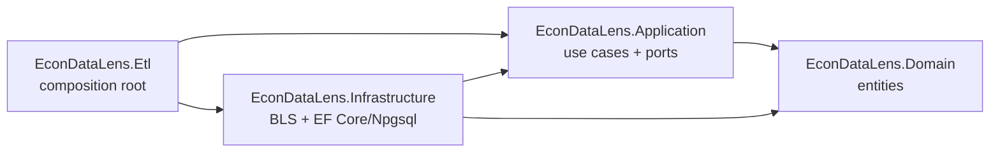

# Architecture

Clean architecture with four source projects. Dependencies point inward.

- **Domain** has no project or package references.
- **Application** references only Domain. It must not reference Infrastructure, EF Core, Npgsql, or `Microsoft.Extensions.Options`.
- **Infrastructure** implements Application's ports.
- **Etl** wires everything and runs it.

`EconDataLens.Tests/Architecture/DependencyRuleTests.cs` fails the build if Domain or Application gain a forbidden reference.

## Ports and adapters

| Port (Application) | Adapter (Infrastructure) | Notes |
| --- | --- | --- |
| `ICpiDataSource` | `Bls/BlsCpiDataSource` | Downloads the file with `BasicFileDownloadService`, then returns a lazy `IAsyncEnumerable<T>` from `CpiDataFileParser`. Methods return `Task<IAsyncEnumerable<T>>` so the network download finishes **before** the repository opens its COPY transaction. |
| `ICpiIngestionRepository` | `Persistence/CpiIngestionRepository` | One `Upsert*Async` per file; see [cpi-etl.md](cpi-etl.md). |

Use cases: `CpiIngestionService` pairs one source stream with one repository upsert per file. `CpiEtlService` calls them in dependency order.

## Composition root

`EconDataLens.Etl/Program.cs`:

1. Build a generic host; call `AddApplication()` and `AddInfrastructure(configuration)`.
2. `Infrastructure.DependencyInjection.MigrateDatabaseAsync` applies EF migrations (exit `2` on failure).
3. `ICpiEtlService.RunEtlAsync()` (exit `1` on failure).
4. Exit `0`.

## Configuration flow

Options classes in `Infrastructure/Bls/` (`BlsOptions`, `CpiOptions`, `DownloadOptions`) are bound from the `BlsOptions` and `DownloadOptions` configuration sections in `Infrastructure/DependencyInjection.cs`. Sources: `appsettings.json` then environment variables (`__` for nesting, e.g. `BlsOptions__UserAgent`). The setting table is in the [README](../README.md#configuration); it is not repeated here.

`EconDataLensDbContextFactory` is design-time only (used by `dotnet ef`); it reads `appsettings.json` and environment variables from the current directory.
